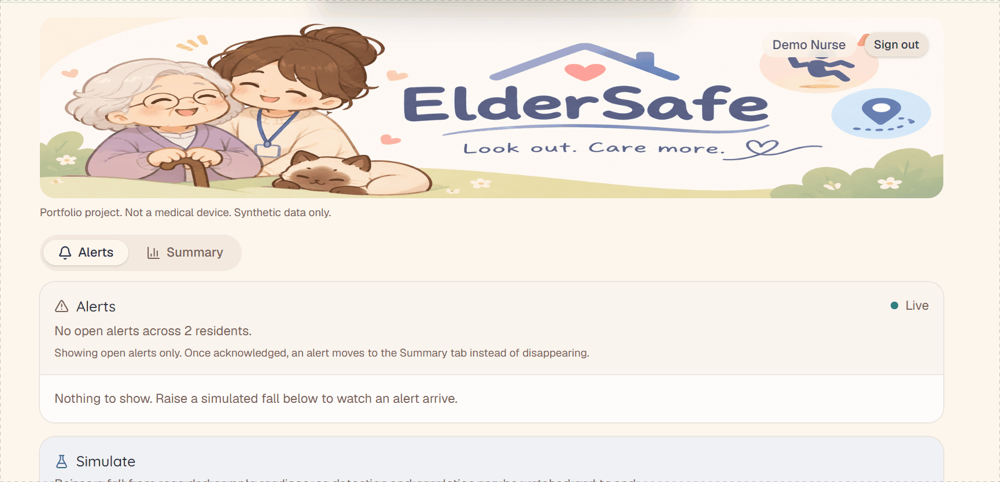

# ElderSafe

**Fall detection for older adults and their caregivers.**

> **Portfolio project. Not a medical device. Synthetic data only.**

ElderSafe alerts a caregiver when a monitored older adult may have fallen. A simulated wearable streams accelerometer data, a detector decides whether a fall happened, and a React dashboard shows live alerts that caregivers acknowledge. Unacknowledged alerts escalate through the assigned caregivers, and can end in a simulated emergency call. A resident account configures who is assigned, in what order, and how escalation and the emergency call behave.

Wandering (leaving a safe zone) detection, a "no data" alert for a silent device, and an AI-generated shift summary are designed and documented but not yet built — see [Not built yet](#not-built-yet).

I built it to show how I work on software in a regulated domain: requirements traced to hazards and tests, automated testing, and a CI pipeline that fails on traceability gaps.



**Live demo:** [eldersafe-dtc4hucbascmcgd8.canadaeast-01.azurewebsites.net](https://eldersafe-dtc4hucbascmcgd8.canadaeast-01.azurewebsites.net) — sign in with `demo.caregiver@example.invalid` / `Demo-Passw0rd!` (see [Run it locally](#run-it-locally) for the full account list). It's on Azure's free tier, so the first request after a quiet period can take a few seconds to wake up.

## Status

Documentation first, then a two-day build. The design is deliberately small, and [the architecture document](docs/05-architecture.md) says what was cut and why.

## How to read this repository

The code is the smaller half of the point. These documents are the other half:

| Document | What it shows |
| --- | --- |
| [Intended use and classification](docs/01-intended-use.md) | What the product is for, and why it is IEC 62304 Class C rather than A or B |
| [Risk management](docs/02-risk-management.md) | 19 hazards scored before and after controls, with residual risk stated honestly |
| [User needs](docs/03-user-needs.md) | Findings from an interview with a registered nurse, and the needs they validated |
| [Software requirements](docs/04-software-requirements.md) | 37 requirements, each traced to a user need and, where it controls one, a hazard; 14 are deferred, each with a recorded reason, rather than hidden |
| [Architecture and ADRs](docs/05-architecture.md) | The design, and seven decision records covering what was traded away |
| [Traceability matrix](docs/traceability.md) | Generated from test results by `tools/generate_traceability.py`, and regenerated by CI on every run. Shows deferred requirements rather than hiding them |

Four things worth a look if you are short of time:

- **Why Class C** ([intended use](docs/01-intended-use.md) section 7) — including why the obvious arguments for Class A and Class B do not hold.
- **Residual risk** ([risk management](docs/02-risk-management.md) section 4) — the part where the design admits what it cannot do.
- **ADR-002** ([rule-based detector](docs/adr/ADR-002-rule-based-detector.md)) — why there is no trained model, and why no accuracy figure is published.
- **ADR-005** ([grounded shift summary](docs/adr/ADR-005-grounded-llm-summary.md)) — the LLM feature is designed around a validator that treats model output as untrusted; not yet built, but the validator's design needs no API key to test.

## Design

One ASP.NET Core process holds the API, the detectors, the alerting logic and an in-process device simulator. A React dashboard talks to it over SignalR. Data lives in a SQLite file.

| Area | Choice | Why |
| --- | --- | --- |
| API | ASP.NET Core, .NET 10 | |
| Dashboard | React 19 + TypeScript + Vite | |
| Live updates | SignalR | |
| Database | SQLite via EF Core | [ADR-001](docs/adr/ADR-001-sqlite-over-postgres.md) |
| Fall detection | Threshold rules, behind an interface | [ADR-002](docs/adr/ADR-002-rule-based-detector.md) |
| Device data | In-process simulator with named scenarios | [ADR-003](docs/adr/ADR-003-in-process-simulator.md) |
| Shift summary | Not built. Designed as grounded generation, validated before display | [ADR-005](docs/adr/ADR-005-grounded-llm-summary.md) |
| Authentication | ASP.NET Core Identity, cookie-based | [ADR-006](docs/adr/ADR-006-identity-cookie-auth.md) |
| Tests | xUnit, `WebApplicationFactory`, `FakeTimeProvider`; Vitest for the dashboard | |
| CI/CD | GitHub Actions | |
| Hosting | Single Azure Web App | [ADR-004](docs/adr/ADR-004-single-web-app.md) |

## Repository layout

```
ElderSafe/
├─ src/
│  ├─ ElderSafe.Api/         API, detectors, alerting, SignalR, simulator
│  └─ ElderSafe.Dashboard/   React + TypeScript caregiver dashboard
├─ tests/
│  └─ ElderSafe.Api.Tests/   unit and integration tests, named by requirement
├─ tools/
│  └─ generate_traceability.py
├─ docs/                     intended use, risk, requirements, architecture, ADRs
└─ .github/                  workflows, pull request template, issue templates
```

## Run it locally

Requires the .NET 10 SDK and Node 22+.

```bash
# API, demo data, and the in-process device simulator
cd src/ElderSafe.Api
dotnet run

# Dashboard, in a second terminal
cd src/ElderSafe.Dashboard
npm install
npm run dev
```

The dashboard runs at `http://localhost:5173` and proxies `/api` and `/hubs` to the API at `http://localhost:5134`. Sign in with one of the seeded demo accounts (password `Demo-Passw0rd!`):

| Account | Role |
| --- | --- |
| `demo.caregiver@example.invalid` | Caregiver, first in the escalation order |
| `demo.nurse@example.invalid` | Caregiver, second in the escalation order |
| `demo.resident@example.invalid` | Resident, configures caregivers and escalation |

From a caregiver's Alerts tab, use the Simulate card to raise a fall from recorded sample readings and watch it arrive, get acknowledged, and show up in the Summary tab.

## Not built yet

Deliberate omissions, each with a reason in the architecture document:

- **No wandering (safe-zone) detection.** REQ-WANDER-01 to 07 are specified and traced to hazards, but not implemented within the build budget. The fall detector sits behind an interface for exactly this reason — a second detector can be added without reworking alerting or escalation.
- **No "no data" alert.** REQ-SYS-01 (alerting when a resident's device goes silent) is specified but not implemented.
- **No AI shift summary.** REQ-AI-01 and REQ-AI-02 are fully designed in [ADR-005](docs/adr/ADR-005-grounded-llm-summary.md) — grounded generation plus a validator that treats model output as untrusted, and that can be tested in CI with no API key — but not yet coded.
- **No trained model.** The detector uses threshold rules. No accuracy figure is published, because any figure measured against this project's own simulator would measure the simulator ([ADR-002](docs/adr/ADR-002-rule-based-detector.md)). The sensitivity and false-alarm targets are REQ-FALL-11, deferred.
- **A failed emergency call is not shown to caregivers.** It is retried on every sweep and written to the audit log, but not shown on the dashboard (REQ-FALL-12, deferred).
- **Reads are not audited.** Acknowledgements, alert events and configuration changes are in the audit log; who viewed a resident's alerts, summary or sensor trace is not (REQ-SEC-05, deferred).
- **Passwords are stored in the app's own database**, hashed by Identity. A real deployment should hand sign-on to Entra ID ([ADR-006](docs/adr/ADR-006-identity-cookie-auth.md)).
- **Alerts reach the dashboard only.** There is no push notification, SMS or call, so a caregiver who is not signed in is not told. Escalation still runs server-side and an emergency call still follows an exhausted chain, but this is the project's largest residual risk ([ADR-007](docs/adr/ADR-007-dashboard-only-notification.md)).
- **No device pairing flow.** Devices authenticate and are bound to a resident, but pairing is seeded. Creating and revoking pairings needs an administrator role that does not exist yet.
- **No FHIR export.** Needs a FHIR server running alongside.
- **No staging slot or infrastructure as code.** Deployed manually to a single Azure Web App, free tier, per [ADR-004](docs/adr/ADR-004-single-web-app.md). The gated pipeline with slots and Bicep is the next piece of work.

## Working agreements

- `main` is protected: changes arrive through pull requests with passing checks.
- Pull request titles follow [Conventional Commits](https://www.conventionalcommits.org/), for example `feat(alerts): escalate after 2 minutes`.
- Each pull request lists the requirement IDs it touches, the tests added and its risk impact.
- Tests carry their requirement ID in their name. CI regenerates the traceability matrix from the test results and fails if any requirement is neither verified by a passing test nor marked deferred with a reason.

## License

[MIT](LICENSE)
