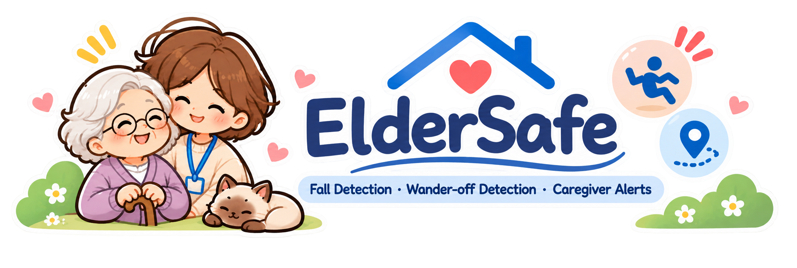

<p align="center">
  
</p>

| | |
| --- | --- |
| **Backend** |    |
| **Frontend** |     |
| **ML** |      |
| **LLM** |   |
| **Delivery** |    |
| **Quality** |    |

**Fall detection for older adults: a trained model decides, caregivers are alerted live, and unanswered alerts escalate.**

> Portfolio project, built as if for a regulated medical domain. **Not a medical device. Public and synthetic data only.**

**[Live demo](https://eldersafe-dtc4hucbascmcgd8.canadaeast-01.azurewebsites.net)**: sign in as `demo.caregiver@example.invalid` / `Demo-Passw0rd!`, press **Simulate fall**, and watch the alert arrive, escalate and get acknowledged. The first request after a quiet period may take a few seconds.


## Highlights

Each highlight follows the same pattern: what was achieved, how it was measured, and how it was built.

- **A trained fall model that outperforms the rules it replaced**<br>
  – **Result:** detected **85.5%** of falls, up from **31.2%** with the hand-tuned rules.<br>
  – **Measured on:** UMAFall, a dataset from a different lab, sensor and set of volunteers, never used in training or tuning.<br>
  – **How:** a **LightGBM** classifier on 8 explainable accelerometer features, trained as an **Azure Machine Learning** job, tracked with **MLflow** and registered in the Azure ML model registry. Validated with subject-wise 5-fold cross-validation; the alert threshold was fixed before the held-out data was scored.<br>
  – **Trade-off:** about twice the rules' false-alarm rate (9.2 vs 4.0 per hour of daily activity), accepted on purpose to catch more falls and recorded in the risk file.<br>
  → [ADR-008](docs/adr/ADR-008-trained-fall-model.md), [model card](docs/models/fall-model-card.md)
- **Fast, verifiable model serving**<br>
  – **Result:** every reading window is scored inside the API, with no network call.<br>
  – **Measured by:** the exact model version recorded in every alert's audit entry, and a startup check that refuses to run a model whose SHA-256 hash doesn't match.<br>
  – **How:** exported the model to **ONNX** and ran it with **ONNX Runtime in .NET**. A parity test keeps the Python (training) and C# (production) feature code producing identical values.
- **An LLM feature that never trusts the model's output**<br>
  – **Result:** handover summaries that flag an unacknowledged alert rose from **3 of 7 to 7 of 7**.<br>
  – **Measured by:** a live evaluation of 10 summaries per prompt version, with **0 invented or missing alerts** in either version.<br>
  – **How:**<br>
  &emsp;– **Azure OpenAI (GPT-4.1-mini, deployed in Microsoft Foundry)** writes the summary from the stored alerts only.<br>
  &emsp;– A code validator withholds any summary that invents an alert or omits an escalated one.<br>
  &emsp;– A template takes over when the model is rate-limited or unavailable.<br>
  &emsp;– Each summary records the prompt and model version that produced it.<br>
  → [ADR-005](docs/adr/ADR-005-grounded-llm-summary.md), including the prompt v1 vs v2 evaluation
- **Medical-software engineering practices**<br>
  – **Result:** all **37 requirements** traced to user needs, hazards and tests, and **22 hazards** scored before and after controls.<br>
  – **Measured by:** a **CI gate** that fails the build when any requirement has no passing test and isn't deferred with a recorded reason.<br>
  – **How:** **IEC 62304 Class C** framing, an ISO 14971-style risk file, and user needs drawn from an interview with a registered nurse.<br>
  → [risk file](docs/02-risk-management.md), [traceability matrix](docs/traceability.md)
- **Real-time alerting with automatic escalation**<br>
  – **Result:** fall alerts appear on caregivers' dashboards live, and an unanswered alert moves on automatically.<br>
  – **Measured by:** escalation to the next caregiver after **2 minutes** without acknowledgement, ending in a simulated emergency call; covered by tests that use a fake clock.<br>
  – **How:** an **ASP.NET Core** API pushing alerts over **SignalR**, a background escalation worker driven by a pure, unit-tested policy, and a **React 19 + TypeScript** dashboard.
- **Security by default**<br>
  – **Result:** no caregiver can see, or even confirm the existence of, another resident's data.<br>
  – **Measured by:** the API answers **404, never 403**, for any resident the caregiver isn't assigned to, verified by automated tests.<br>
  – **How:** relationship-based authorization on **ASP.NET Core Identity** cookie sign-in, separate API-key authentication for devices, and secrets kept out of the repository, with the full history scanned.
- **Shipped like production software**<br>
  – **Result:** every pull request is gated, and only a tested image reaches production.<br>
  – **Measured by:** **258 tests (187 xUnit + 71 Vitest)**, lint and the traceability check on every pull request, plus a smoke test of the built container (sign in, simulate a fall, confirm the alert).<br>
  – **How:** **GitHub Actions** pipelines that build a **Docker** image, test it, and publish that same image to **GHCR**, where **Azure App Service** runs it.<br>
  → [ADR-009](docs/adr/ADR-009-container-deployment.md)

## How it works

```
Wearable (simulated) ──readings──▶ ASP.NET Core API ──SignalR──▶ React dashboard
                                     │
                    4 s window ──▶ IFallDetector ── ONNX model (default) | threshold rules
                                     │ fall
                                     ▼
                     Alert ─▶ escalate through caregivers every 2 min ─▶ simulated emergency call
                                     │
                     Shift summary ─▶ Azure OpenAI or template ─▶ validator ─▶ shown or withheld
```

One process, one SQLite file, one container. Domain decisions such as detection and escalation are pure classes behind interfaces, and side effects go through ports. Emergency calls are **simulated**: nothing in the system can place a real call.

## Run it locally

Requires the .NET 10 SDK and Node 22+.

```bash
cd src/ElderSafe.Api && dotnet run            # API on :5134, seeds demo data
cd src/ElderSafe.Dashboard && npm install && npm run dev   # dashboard on :5173
```

Or run the deployed image: `docker run -p 8080:8080 -e DemoData__Enabled=true -e Simulation__Enabled=true ghcr.io/jiawen-wang06/eldersafe:latest`

Demo accounts (password `Demo-Passw0rd!`): `demo.caregiver@example.invalid` and `demo.nurse@example.invalid`, the caregivers in escalation order, and `demo.resident@example.invalid`, who configures them.

<details>
<summary>Optional: turn on AI shift summaries</summary>

Without setup, summaries come from a template. To use an Azure OpenAI deployment instead, store its details as user secrets (in Azure, as App Service settings with `__` in place of `:`):

```bash
cd src/ElderSafe.Api
dotnet user-secrets set "ShiftSummary:AzureOpenAI:Endpoint" "https://<your-resource>.cognitiveservices.azure.com/"
dotnet user-secrets set "ShiftSummary:AzureOpenAI:Deployment" "<your-deployment-name>"
dotnet user-secrets set "ShiftSummary:AzureOpenAI:ApiKey" "<your-key>"
```
</details>

## Documentation

| Document | What it shows |
| --- | --- |
| [Intended use](docs/01-intended-use.md) | Why the software is IEC 62304 Class C rather than A or B |
| [Risk management](docs/02-risk-management.md) | 22 hazards, controls, and residual risk stated honestly |
| [User needs](docs/03-user-needs.md) | Findings from an interview with a registered nurse |
| [Requirements](docs/04-software-requirements.md) | 37 requirements; 12 deferred, each with a recorded reason |
| [Architecture](docs/05-architecture.md) and [ADRs](docs/adr/) | The design, and 9 decision records covering what was traded away |
| [Fall model card](docs/models/fall-model-card.md) | Data, licences, features, held-out results and limitations |
| [SOUP list](docs/06-soup.md) | Third-party software and how reliance on it is checked |
| [Traceability matrix](docs/traceability.md) | Generated from test results by CI on every run |

## Known limitations

Each limitation is stated in the docs rather than hidden:
- **No accuracy claim for real falls.** Every fall in the training and test data was simulated by a young adult, and the false-alarm rate is above any product target, so REQ-FALL-11 stays deferred.
- **Alerts reach the dashboard only.** There's no push or SMS, which makes this the largest residual risk ([ADR-007](docs/adr/ADR-007-dashboard-only-notification.md)).
- **Data resets when the container restarts,** because SQLite lives inside the container. There's no staging slot or Bicep yet.
- **Not built yet:** wandering detection, the "no data" alert, a device-pairing flow and FHIR export. All are specified, traced and marked deferred.

## Datasets and credit

The fall model was trained and evaluated on the following publicly available datasets. Grateful acknowledgement is extended to the researchers who collected and published them.

| Dataset | Used for | Licence |
| --- | --- | --- |
| **Simulated Falls and Daily Living Activities**: A. T. Özdemir and B. Barshan, Bilkent University. [UCI Machine Learning Repository](https://archive.ics.uci.edu/dataset/455/simulated+falls+and+daily+living+activities+data+set), [doi:10.24432/C52028](https://doi.org/10.24432/C52028). Paper: *Detecting Falls with Wearable Sensors Using Machine Learning Techniques*, Sensors 14(6), 2014 ([PMC4118339](https://pmc.ncbi.nlm.nih.gov/articles/PMC4118339)) | Training and cross-validation | CC BY 4.0 |
| **UMAFall**: E. Casilari and J. A. Santoyo-Ramón, University of Málaga. [figshare, doi:10.6084/m9.figshare.4214283](https://doi.org/10.6084/m9.figshare.4214283). Paper: *UMAFall: A Multisensor Dataset for the Research on Automatic Fall Detection*, Procedia Computer Science 110, 2017 | Held-out external test only | CC BY-NC 4.0 |

Neither dataset is redistributed in this repository. Only the waist-sensor recordings were used, and the volunteers' personal-information files were never extracted. See the [model card](docs/models/fall-model-card.md).

## Working agreements

- `main` is protected, and every change goes through a pull request.
- PR titles follow Conventional Commits.
- Every test carries its requirement ID, which is what lets CI regenerate the traceability matrix.

## License

All rights reserved. See [LICENSE](LICENSE). This repository is public for review, not for reuse.
