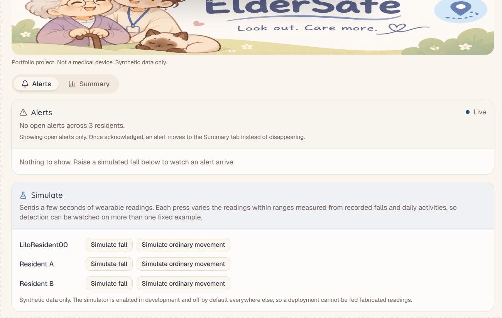

<p align="center">
  
</p>

| | |
| --- | --- |
| **Backend** |    |
| **Frontend** |     |
| **ML** |      |
| **LLM** |   |
| **Delivery** |    |
| **Quality** |    |

**Fall detection for older adults: a trained model decides, caregivers are alerted live, and unanswered alerts escalate.**

> Portfolio project, built as if for a regulated medical domain. **Not a medical device. Public and synthetic data only.**

**[Live demo](https://eldersafe-dtc4hucbascmcgd8.canadaeast-01.azurewebsites.net)**: sign in as `demo.caregiver@example.invalid` / `Demo-Passw0rd!`, press **Simulate fall**, and watch the alert arrive, escalate and get acknowledged. The first request after a quiet period may take a few seconds.



## Highlights

Each highlight states the outcome achieved, how it is measured, and the approach used.

- **Raised fall detection on unseen data from 31.2% to 85.5%,** by replacing hand-tuned rules with a LightGBM classifier trained in Azure Machine Learning.
  - Uses 8 explainable accelerometer features, tracked with MLflow and registered in the Azure ML model registry.
  - Validated with subject-wise 5-fold cross-validation, then tested once on UMAFall, a dataset from a different lab and sensor.
  - Trade-off stated openly: about twice the rules' false-alarm rate, accepted to catch more falls.
- **Served the model with no network calls and a verifiable version on every alert,** by exporting it to ONNX and running it in-process with ONNX Runtime in .NET.
  - Refuses to start if the model file's SHA-256 hash doesn't match its metadata.
  - A parity test keeps the Python training features and C# production features identical.
- **Raised handover summaries that flag unacknowledged alerts from 3 of 7 to 7 of 7, with 0 invented alerts,** by grounding Azure OpenAI (GPT-4.1-mini on Microsoft Foundry) in stored alerts and validating its output in code.
  - Withholds any summary that invents an alert or omits an escalated one.
  - Falls back to a template when the model is unavailable.
  - Records the prompt and model version with every summary.
- **Traced all 37 requirements to user needs, hazards and tests, across 22 scored hazards,** by applying IEC 62304 Class C practices and a CI gate that fails the build on any untested requirement.
  - User needs come from an interview with a registered nurse.
  - Deferred requirements must state a reason, or the build fails.
- **Delivered live fall alerts that escalate after 2 minutes without acknowledgement,** by pushing alerts over SignalR from an ASP.NET Core API to a React 19 + TypeScript dashboard.
  - Escalates through the caregiver order, then to a simulated emergency call.
  - The escalation policy is a pure function, tested with a fake clock.
- **Prevented caregivers from seeing, or confirming the existence of, another resident's data** (404, never 403), by enforcing relationship-based authorization on ASP.NET Core Identity.
  - Wearables authenticate separately, with per-device API keys.
  - Secrets stay out of the repository, and the full history is scanned.
- **Gated every pull request on 258 tests and shipped only a smoke-tested image,** through a Docker and GitHub Actions pipeline to Azure App Service.
  - 187 xUnit and 71 Vitest tests, plus lint and the traceability check.
  - CI starts the container, signs in, simulates a fall and confirms the alert before publishing that same image to GHCR.

## Skills Demonstrated

- **AI and ML Engineering**
  - Model training and evaluation: LightGBM, subject-wise cross-validation, held-out testing and a model card.
  - MLOps: Azure Machine Learning jobs, MLflow tracking, model registry, ONNX export and integrity checks.
  - LLM engineering: grounding, output validation, prompt versioning, live evaluation and graceful fallback.
- **Software Engineering**
  - .NET 10, ASP.NET Core, SignalR, Identity, EF Core and SQLite.
  - React 19, TypeScript, Vite, Tailwind CSS and shadcn/ui.
  - Pure domain logic behind interfaces, tested with xUnit and Vitest.
- **Regulated and Secure Delivery**
  - IEC 62304 lifecycle, ISO 14971 risk management and requirement traceability.
  - Relationship-based authorization and secret hygiene.
  - Docker, GitHub Actions, GitHub Container Registry and Azure App Service.

**Read more:** [model card](docs/models/fall-model-card.md) · [ADR-008: trained model](docs/adr/ADR-008-trained-fall-model.md) · [ADR-005: LLM summary](docs/adr/ADR-005-grounded-llm-summary.md) · [risk file](docs/02-risk-management.md) · [traceability matrix](docs/traceability.md) · [ADR-009: deployment](docs/adr/ADR-009-container-deployment.md)

## How it works

```
Wearable (simulated) ──readings──▶ ASP.NET Core API ──SignalR──▶ React dashboard
                                     │
                    4 s window ──▶ IFallDetector ── ONNX model (default) | threshold rules
                                     │ fall
                                     ▼
                     Alert ─▶ escalate through caregivers every 2 min ─▶ simulated emergency call
                                     │
                     Shift summary ─▶ Azure OpenAI or template ─▶ validator ─▶ shown or withheld
```

One process, one SQLite file, one container. Domain decisions such as detection and escalation are pure classes behind interfaces, and side effects go through ports. Emergency calls are **simulated**: nothing in the system can place a real call.

## Run it locally

Requires the .NET 10 SDK and Node 22+.

```bash
cd src/ElderSafe.Api && dotnet run            # API on :5134, seeds demo data
cd src/ElderSafe.Dashboard && npm install && npm run dev   # dashboard on :5173
```

Or run the deployed image: `docker run -p 8080:8080 -e DemoData__Enabled=true -e Simulation__Enabled=true ghcr.io/jiawen-wang06/eldersafe:latest`

Demo accounts (password `Demo-Passw0rd!`): `demo.caregiver@example.invalid` and `demo.nurse@example.invalid`, the caregivers in escalation order, and `demo.resident@example.invalid`, who configures them.

<details>
<summary>Optional: turn on AI shift summaries</summary>

Without setup, summaries come from a template. To use an Azure OpenAI deployment instead, store its details as user secrets (in Azure, as App Service settings with `__` in place of `:`):

```bash
cd src/ElderSafe.Api
dotnet user-secrets set "ShiftSummary:AzureOpenAI:Endpoint" "https://<your-resource>.cognitiveservices.azure.com/"
dotnet user-secrets set "ShiftSummary:AzureOpenAI:Deployment" "<your-deployment-name>"
dotnet user-secrets set "ShiftSummary:AzureOpenAI:ApiKey" "<your-key>"
```
</details>

## Documentation

| Document | What it shows |
| --- | --- |
| [Intended use](docs/01-intended-use.md) | Why the software is IEC 62304 Class C rather than A or B |
| [Risk management](docs/02-risk-management.md) | 22 hazards, controls, and residual risk stated honestly |
| [User needs](docs/03-user-needs.md) | Findings from an interview with a registered nurse |
| [Requirements](docs/04-software-requirements.md) | 37 requirements; 12 deferred, each with a recorded reason |
| [Architecture](docs/05-architecture.md) and [ADRs](docs/adr/) | The design, and 9 decision records covering what was traded away |
| [Fall model card](docs/models/fall-model-card.md) | Data, licences, features, held-out results and limitations |
| [SOUP list](docs/06-soup.md) | Third-party software and how reliance on it is checked |
| [Traceability matrix](docs/traceability.md) | Generated from test results by CI on every run |

## Known limitations

Each limitation is stated in the docs rather than hidden:
- **No accuracy claim for real falls.** Every fall in the training and test data was simulated by a young adult, and the false-alarm rate is above any product target, so REQ-FALL-11 stays deferred.
- **Alerts reach the dashboard only.** There's no push or SMS, which makes this the largest residual risk ([ADR-007](docs/adr/ADR-007-dashboard-only-notification.md)).
- **Data resets when the container restarts,** because SQLite lives inside the container. There's no staging slot or Bicep yet.
- **Not built yet:** wandering detection, the "no data" alert, a device-pairing flow and FHIR export. All are specified, traced and marked deferred.

## Datasets and credit

The fall model was trained and evaluated on the following publicly available datasets. Grateful acknowledgement is extended to the researchers who collected and published them.

| Dataset | Used for | Licence |
| --- | --- | --- |
| **Simulated Falls and Daily Living Activities**: A. T. Özdemir and B. Barshan, Bilkent University. [UCI Machine Learning Repository](https://archive.ics.uci.edu/dataset/455/simulated+falls+and+daily+living+activities+data+set), [doi:10.24432/C52028](https://doi.org/10.24432/C52028). Paper: *Detecting Falls with Wearable Sensors Using Machine Learning Techniques*, Sensors 14(6), 2014 ([PMC4118339](https://pmc.ncbi.nlm.nih.gov/articles/PMC4118339)) | Training and cross-validation | CC BY 4.0 |
| **UMAFall**: E. Casilari and J. A. Santoyo-Ramón, University of Málaga. [figshare, doi:10.6084/m9.figshare.4214283](https://doi.org/10.6084/m9.figshare.4214283). Paper: *UMAFall: A Multisensor Dataset for the Research on Automatic Fall Detection*, Procedia Computer Science 110, 2017 | Held-out external test only | CC BY-NC 4.0 |

Neither dataset is redistributed in this repository. Only the waist-sensor recordings were used, and the volunteers' personal-information files were never extracted. See the [model card](docs/models/fall-model-card.md).

## Working agreements

- `main` is protected, and every change goes through a pull request.
- PR titles follow Conventional Commits.
- Every test carries its requirement ID, which is what lets CI regenerate the traceability matrix.

## License

All rights reserved. See [LICENSE](LICENSE). This repository is public for review, not for reuse.
