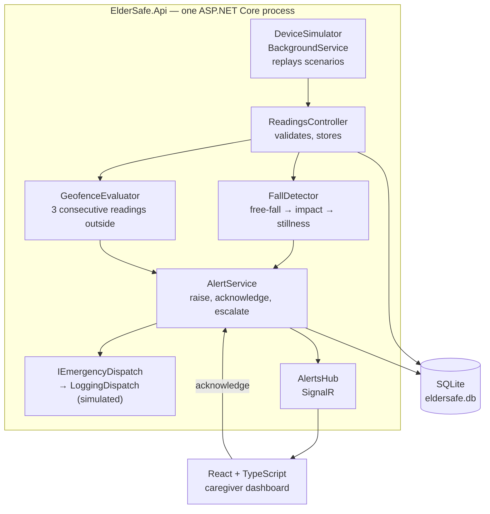

# 05. Architecture and design

| | |
| --- | --- |
| **Product** | ElderSafe |
| **Document status** | Draft v0.1 |
| **Date** | 2026-11-05 |
| **Safety class** | C (see [intended use](01-intended-use.md) section 7) |
| **Related documents** | [Risk management](02-risk-management.md), [Software requirements](04-software-requirements.md), [ADRs](adr/) |

> **Portfolio project. Not a medical device. Synthetic data only.**

## 1. The constraint that shapes this design

This is a learning and demonstration project with a **1 to 2 day build budget**. That constraint is treated as a requirement, not an excuse, and it drives every decision below.

The guiding rule: **one process, one database file, no infrastructure to stand up.** Anything that requires a second service, a training pipeline or a cloud account to run locally is deferred.

A reviewer should be able to clone the repository and have it running with two commands.

## 2. Scope: what is built and what is deferred

| Capability | Decision | Why |
| --- | --- | --- |
| Fall detection | **Built**, rule-based threshold detector | A trained model needs a dataset, a training pipeline and a day of tuning. See [ADR-002](adr/ADR-002-rule-based-detector.md) |
| Wandering detection | **Built**, circular geofence | Plain geometry, a few hours including tests |
| Alerting, acknowledgement, escalation | **Built** | This is the core of the product and the part the risk file cares about most |
| Emergency call | **Built**, against a simulated dispatch service | An interface and a logging implementation. Cheap, and it demonstrates the design |
| Safe-zone and escalation configuration | **Built** | Straightforward CRUD, required by REQ-FALL-04 and REQ-WANDER-07 |
| Caregiver dashboard | **Built**, React + TypeScript, one screen | Kept because the target role requires React and TypeScript |
| Device simulator | **Built**, in-process background service | Avoids a second process. See [ADR-003](adr/ADR-003-in-process-simulator.md) |
| Database | **Built**, SQLite through EF Core | No container, no server. See [ADR-001](adr/ADR-001-sqlite-over-postgres.md) |
| Shift summary | **Built**, grounded generation with a validator | The guardrail is the valuable part and needs no API key to test. See [ADR-005](adr/ADR-005-grounded-llm-summary.md) |
| Trained ML model | **Deferred** | Needs a dataset and training time. The detector sits behind an interface so a model can replace the rules later |
| FHIR export | **Deferred** | Needs a HAPI FHIR server running alongside |
| Caregiver authentication and per-resident authorization | **Built**, ASP.NET Core Identity with cookies | The data is personal health information; a stub would leave the hazard uncontrolled. See [ADR-006](adr/ADR-006-identity-cookie-auth.md) |
| Azure deployment | **Built**, single Web App | One `az webapp up`, no Bicep on day one |

Deferred items stay in the requirements register with no passing test, so `traceability.md` shows the gaps honestly rather than hiding them.

## 3. Component view



Everything inside the box is one process. The dashboard is static files served by the same app in production.

## 4. Components

| Component | Responsibility | Requirements |
| --- | --- | --- |
| `DeviceSimulator` | Replays named scenarios as readings: normal activity, a fall, GPS drift at the zone edge, a wander, device goes silent | Test support for all |
| `ReadingsController` | Accepts readings over HTTP, validates, persists, passes to the detectors | — |
| `FallDetector` | Decides whether a window of readings contains a fall | REQ-FALL-01 |
| `GeofenceEvaluator` | Decides whether a resident is outside the safe zone, and for how many readings | REQ-WANDER-01 |
| `AlertService` | Raises alerts, tracks acknowledgement, runs escalation timers, decides when to dispatch | REQ-FALL-02 to 06, REQ-WANDER-02 to 06, REQ-SYS-01 |
| `IEmergencyDispatch` | Abstraction over placing an emergency call. Implemented by `LoggingDispatch` | REQ-FALL-06, REQ-WANDER-06 |
| `AlertsHub` | Pushes new and escalated alerts to connected dashboards | REQ-FALL-02, REQ-WANDER-02 |
| Identity | ASP.NET Core Identity. `Caregiver` derives from `IdentityUser`, so the caregiver *is* the authenticated user | REQ-SEC-03 |
| `ResidentAccessGuard` | Checks that the signed-in caregiver is assigned to the resident being requested | REQ-SEC-01 |
| `AuditLog` | Append-only record of views, acknowledgements and configuration changes, attributed to the signed-in caregiver | REQ-SEC-02 |
| `ShiftSummaryService` | Builds a grounded prompt from stored events, calls a generator, validates the result | REQ-AI-01, REQ-AI-02 |
| `ISummaryGenerator` | Abstraction over text generation. Two implementations: an LLM client, and a deterministic template generator used offline and in CI | REQ-AI-01 |
| `SummaryValidator` | Rejects a summary citing an event ID that is not in the input, or omitting an escalated alert | REQ-AI-02 |
| Dashboard | One screen: open alerts, acknowledge, resident settings, "simulate" buttons | — |

### The fall detector

A fall has a recognizable three-part shape in accelerometer magnitude, and finding F-01 (a fall takes under three seconds) sets the window:

1. **Free fall** — magnitude drops below about 0.6 g
2. **Impact** — magnitude spikes above about 2.5 g within roughly a second of the drop
3. **Stillness** — low variance for about two seconds after the impact

All three must occur inside a 3-second window. The stillness stage is what separates a fall from sitting down heavily or dropping the device, and it is the stage most worth unit-testing.

The thresholds live in configuration, not in code, so they can be tuned without a rebuild.

```csharp
public interface IFallDetector
{
    FallVerdict Evaluate(IReadOnlyList<Reading> window);
}
```

A trained model implements the same interface later. Nothing else changes.

### The shift summary

The summary is not "send the events to a model and print what comes back." The useful structure is three parts, and only the middle one needs a model:

1. **Ground.** Build the prompt from stored events only. Each event carries its ID, and the prompt instructs the model to cite the ID of every event it mentions. Resident identifiers go in; names do not.
2. **Generate.** `ISummaryGenerator` produces text. `OpenAiSummaryGenerator` calls a model. `TemplateSummaryGenerator` produces a deterministic summary from the same events with no network call, and is the default when no key is configured.
3. **Validate.** `SummaryValidator` checks the output against the input events: every cited ID must exist, no ID may be cited that was not supplied, and every escalated alert must appear. A summary that fails is rejected rather than shown.

The validator is a pure function over the events and the text. It needs no API key, runs in milliseconds, and is where the tests live. That is deliberate: the guardrail is the part a reviewer in this domain cares about, and it is also the part that can be proven in CI for free.

This arrangement means the feature is complete and testable now, and switching on a real model later is a configuration change rather than new code.

### Escalation

One hosted service ticks every few seconds and looks for alerts that are open, unacknowledged and older than the timeout. For each it escalates to the next caregiver, or dispatches if the chain is exhausted and the setting is on.

`TimeProvider` is injected everywhere a timer is involved, so tests advance a fake clock instead of waiting two minutes.

## 5. Data model

Six domain tables plus Identity's own, all in one `ElderSafeDbContext` deriving from `IdentityDbContext<Caregiver>`, created by EF Core migrations.

| Table | Key columns |
| --- | --- |
| `Residents` | Id, DisplayName, SafeZoneLat, SafeZoneLng, SafeZoneRadiusMeters, EscalationLimit, EmergencyCallEnabled |
| `Caregivers` | Derives from `IdentityUser`: Id, UserName, Email, PasswordHash, plus DisplayName |
| `ResidentCaregivers` | ResidentId, CaregiverId, Order |
| `Readings` | Id, ResidentId, Timestamp, AccelX/Y/Z, Lat, Lng, AccuracyMeters |
| `Alerts` | Id, ResidentId, Kind (Fall/Wander/NoData), RaisedAt, State, AcknowledgedBy, AcknowledgedAt, EscalationLevel, DispatchedAt |
| `AuditEntries` | Id, At, Actor, Action, ResidentId, Detail |

`Readings` grows quickly under simulation. A background cleanup keeps the most recent few hours, which is enough for a demo.

## 6. Key flows

**A fall becomes an alert**

1. Simulator emits readings at 20 Hz for a scenario.
2. `ReadingsController` stores each reading and hands the last 3 seconds to `FallDetector`.
3. On a positive verdict, `AlertService` creates an Alert in state `Open` at escalation level 0.
4. `AlertsHub` pushes it to every connected dashboard for that resident's first caregiver.
5. If no acknowledgement arrives within the timeout, the escalation service moves it to level 1, and so on.
6. If the level passes the resident's `EscalationLimit` and `EmergencyCallEnabled` is true, `IEmergencyDispatch` is called exactly once, and `DispatchedAt` is stamped so it cannot repeat.

**Acknowledgement** stops escalation, records the caregiver and time, writes an audit entry and pushes the state change to all dashboards.

## 7. Repository layout

```
src/
  ElderSafe.Api/            ASP.NET Core: controllers, hub, services, EF Core
  ElderSafe.Dashboard/      Vite + React + TypeScript
tests/
  ElderSafe.Api.Tests/      xUnit: detector, geofence, escalation, API
tools/
  generate_traceability.py
```

The earlier plan had four source projects. Two is enough, and fewer moving parts is the point.

## 8. Technology choices

| Area | Choice | Note |
| --- | --- | --- |
| API | ASP.NET Core 8, minimal hosting | |
| Live updates | SignalR | A WebSocket by hand would cost more than it saves |
| Database | SQLite via EF Core | [ADR-001](adr/ADR-001-sqlite-over-postgres.md) |
| Detection | Rule-based thresholds | [ADR-002](adr/ADR-002-rule-based-detector.md) |
| Simulator | In-process `BackgroundService` | [ADR-003](adr/ADR-003-in-process-simulator.md) |
| Shift summary | Grounded generation behind an interface, with a validator | [ADR-005](adr/ADR-005-grounded-llm-summary.md) |
| Authentication | ASP.NET Core Identity, cookie-based | [ADR-006](adr/ADR-006-identity-cookie-auth.md) |
| Dashboard | React 18 + TypeScript + Vite | Required by the target role |
| Tests | xUnit, `WebApplicationFactory`, `FakeTimeProvider` | |
| Deployment | Single Azure Web App | [ADR-004](adr/ADR-004-single-web-app.md) |

## 9. Build order

**Day 1 — the alert path works end to end**

| Step | Output |
| --- | --- |
| 1 | Solution, two projects, EF Core model with Identity, migration, seeded caregivers and residents |
| 2 | `FallDetector` with unit tests tagged REQ-FALL-01 |
| 3 | `GeofenceEvaluator` with unit tests tagged REQ-WANDER-01 |
| 4 | `AlertService` with escalation, unit tests on a fake clock, tagged REQ-FALL-03 and REQ-WANDER-03 |
| 5 | Readings endpoint, SignalR hub, simulator with three scenarios |

**Day 2 — a person can see and use it**

| Step | Output |
| --- | --- |
| 6 | Authentication: Identity with cookies, sign-in screen, `[Authorize]` on every resident endpoint, authorization guard and its tests (REQ-SEC-01, REQ-SEC-02, REQ-SEC-03) |
| 6b | React dashboard: sign in, open alerts, acknowledge, "simulate a fall" button |
| 7 | `LoggingDispatch` and its integration test (REQ-FALL-06) |
| 8 | Shift summary: grounded prompt, template generator, `SummaryValidator` with unit tests (REQ-AI-01, REQ-AI-02) |
| 9 | CI workflow: build, test, run the traceability check |
| 10 | Deploy to Azure, README with a GIF, release v0.1 |
| 11 | Resident settings screen: safe zone, escalation limit, emergency-call toggle (REQ-FALL-04, 05, REQ-WANDER-07) |

Authentication added roughly two to three hours to day 2, taken from the settings screen. Steps 9 and 10 matter more to a reviewer than step 11, so the settings screen is last and may be configured through seeded data until there is time for it. Step 8's validator tests are cheap and distinctive, so they stay ahead of it.

## 10. What this design gives up

Stated plainly, because a reviewer will spot it anyway:

- **The detector is not trained or validated.** Rules tuned by hand on simulated data say nothing about accuracy on real falls. REQ-FALL-01's acceptance criteria cannot be met by this build. Measuring sensitivity against a simulator that the same author wrote measures the simulator, not the detector.
- **SQLite is single-writer.** Fine for one process and a demo, wrong for a real deployment.
- **Passwords live in the application's own database.** Hashed by Identity, but a real deployment should hand sign-on to Entra ID and store none ([ADR-006](adr/ADR-006-identity-cookie-auth.md)).
- **The live demo has published credentials.** Anyone who reads the README can sign in, which is only acceptable because every record is synthetic.
- **In-process scheduling.** Escalation timers die with the process. A real system needs durable scheduling.
- **No FHIR export.** Deferred entirely.
- **The shift summary ships with the template generator by default.** The grounding and the validator are real and tested, but unless a key is configured the text is produced from a template rather than a model. The validator behaves identically either way, which is the point, but no claim is made about a real model's output quality until one has been run against the evaluation scenarios.

Each of these is a deliberate trade against the two-day budget, and each is recorded as future work in the README.

## 11. Revision history

| Version | Date | Change |
| --- | --- | --- |
| 0.1 | 2026-11-05 | First draft, scoped to a 1 to 2 day build |
